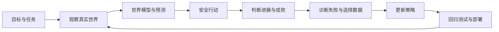

# Physical AI: Closing the Embodied Iteration Loop

> A public, problem-first research lab for helping AI learn from the physical world.

本项目的出发点不是一个等待证明的市场判断，而是一条北极星：

> **机器人是 AI 进入物理世界的接口。它让 AI 能观察、行动、接受真实反馈，并最终在原子世界形成自我迭代。**

这里不把“做一台会表演的机器人”当终点。真正的目标是跑通一条可度量、可纠错、可持续加速的闭环：



机器人本体只是这条链上的一环。没有可靠的 verifier（验证器：判断任务是否成功、进展到哪里）、失败数据、策略更新和回归测试，机器人不会因为“接触了现实”就自动变聪明。

## 当前判断

- 世界模型正在从“生成看起来合理的世界”走向 action-conditioned prediction（动作条件预测：预测采取某个动作后世界如何变化）。
- 机器人行业的共同瓶颈正在收敛到真实数据、成功检测、跨本体泛化、长任务恢复和可规模部署。
- 本项目的第一项研究赌注是 **Embodied Iteration Engine（具身迭代引擎）**：把执行、评价、失败归因、纠正数据、再训练和防回归部署连成一个开放闭环。
- 选择它不是因为它容易，而是因为**没有可信反馈，就没有自我迭代；没有自我迭代，世界模型和机器人本体都只是静态能力展示**。

## 从这里读起

| 文档 | 回答的问题 |
|---|---|
| [Thesis](docs/THESIS.md) | 哪些是信仰，哪些实现假设必须接受证伪？ |
| [Company landscape](docs/LANDSCAPE.md) | 现阶段重要公司分别在攻哪一层？ |
| [Problem map](docs/PROBLEM_MAP.md) | 真正卡住物理 AI 的关键问题是什么？ |
| [Entry strategy](docs/ENTRY_STRATEGY.md) | 为什么从具身迭代闭环切入，以及具体做什么？ |
| [90-day roadmap](docs/ROADMAP.md) | 如何从仿真走到真实机器证据？ |
| [Research method](docs/RESEARCH_METHOD.md) | 如何区分宣传、演示、基准和真实部署？ |
| [Decision log](DECISIONS.md) | 项目的稳定决策与修改理由 |

机器可读的公司与问题数据位于 [`research/`](research/)，可复用实验模板位于 [`experiments/`](experiments/)。已有的 [`mujoco-intuition-lab/`](mujoco-intuition-lab/) 是第一块仿真学习资产；两个课程仓库继续保持独立 Git 历史，不进入本公开仓库。

[MicroDuck 本地环境](microduck-sim/README.md)包含浏览器仿真、训练源码和双击启动脚本；仿真与训练仓库各自保留独立 Git 历史，整套环境不纳入本公开仓库。

[SO-101 与 LeRobot 本地环境](lerobot-sim/README.md)提供免费物理仿真、手动演示记录、LeRobot 数据集导出与动作重放，并整理了 CMU 共享硬件的申请路径。

## 工作方式

每两周只押一个可能改变方向的不确定性，并交付四样东西：

1. 一个可证伪问题；
2. 一个可复现实验；
3. 一份失败和扰动证据；
4. 一个继续、换路或停止的裁决。

项目不按“学了多少工具”计分，而按闭环是否更短、失败是否更可解释、策略是否真的进步、结果能否迁移到真实机器计分。

## 快速验证

```bash
python3 scripts/validate_research.py
```

研究版图最后核验于 **2026-08-04**。活跃公司信息超过 90 天未回读官方来源即视为过期。
