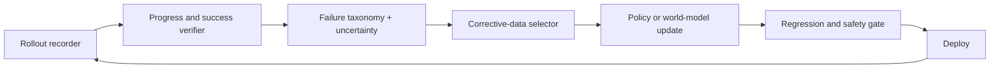

# Entry strategy: build the gradient for embodied self-improvement

## Selection rule

We first asked which problem most constrains the end state, then asked whether a credible path exists to attack it. We did not start from the current résumé and search for a convenient robotics-shaped task.

A first bet must:

1. shorten the real-world learn–evaluate–redeploy cycle;
2. compound across tasks or robot bodies;
3. expose a falsifiable research question within weeks;
4. have an open path from simulation to real hardware;
5. produce artifacts that another team can reproduce or reject.

## Options considered

| Option | Importance | Why it is not the first bet |
|---|---|---|
| Build a new humanoid body | Very high | Capital, manufacturing, safety, and actuator depth make meaningful differentiation inaccessible as a first move |
| Train a frontier generalist policy from scratch | Very high | The required proprietary robot data and compute would turn the project into a small imitation of better-funded labs |
| Build a visually impressive world model | High | It risks optimizing pixels without proving better physical decisions |
| Automate one narrow customer task | Medium to high | It may create value, but can trap the project in task-specific integration before a general learning asset exists |
| **Build an Embodied Iteration Engine** | **Critical** | Selected: it attacks the feedback gradient, can begin openly, and becomes more valuable as models and bodies improve |

The match with existing production software, evaluation, and AI-system experience increases the probability of execution. It did not define the problem's importance.

## Flagship: Embodied Iteration Engine

The engine turns every robot attempt into an auditable learning event:

### Core research questions

- **RQ1 — Verification:** Can a general reward/progress model remain calibrated when objects, lighting, instructions, and camera viewpoints change?
- **RQ2 — Data selection:** Does choosing demonstrations and interventions from observed failure clusters improve success faster than random additional data?
- **RQ3 — Counterfactual prediction:** Can an action-conditioned world model rank candidate action chunks better than policy confidence or a state-only baseline?
- **RQ4 — Recovery:** Can failure-aware policies recover without resets, and how much do they reduce human intervention?
- **RQ5 — Transfer:** Which parts of the loop survive the move from simulation to a physical arm, and which errors appear only in atoms?

### Minimum architecture

- A common rollout record: observations, actions, robot state, timing, task, controller, interventions, and outcome.
- Layered verification: learned video/task judgment, deterministic task checks, and safety constraints.
- A failure vocabulary that distinguishes perception, planning, control, contact, timing, task specification, and verifier errors.
- A selector that asks for the next most informative correction or demonstration.
- Reproducible policy updates and a promotion gate that rejects regressions.
- A report showing success, recovery, intervention burden, data efficiency, and calibration—not only training loss.

### Non-goals

- A monitoring dashboard with no demonstrated policy improvement.
- A custom integration that works for exactly one robot and one task.
- A hero video without seeds, perturbations, failures, and raw traces.
- A benchmark that can be gamed by learning visual shortcuts instead of task causality.

## The deeper path

This entry is not a permanent box labeled “evaluation engineer.” It opens three frontier directions:

1. **Reward and verifier research:** what constitutes trustworthy physical feedback?
2. **Action-conditioned world models:** can imagined futures choose real actions?
3. **Autonomous science:** can the same loop select and run experiments that generate genuinely new evidence?

The desired trajectory is therefore: **measure the loop → improve the loop → model the loop → let the loop design better experiments.**
