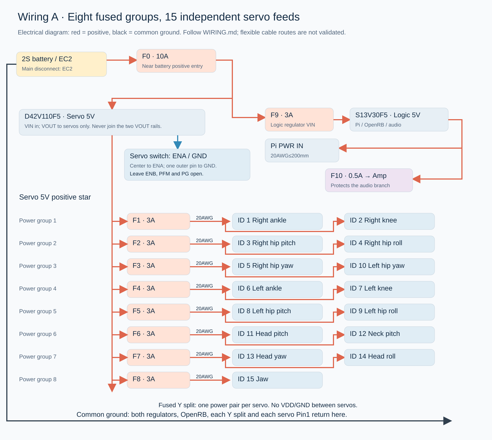
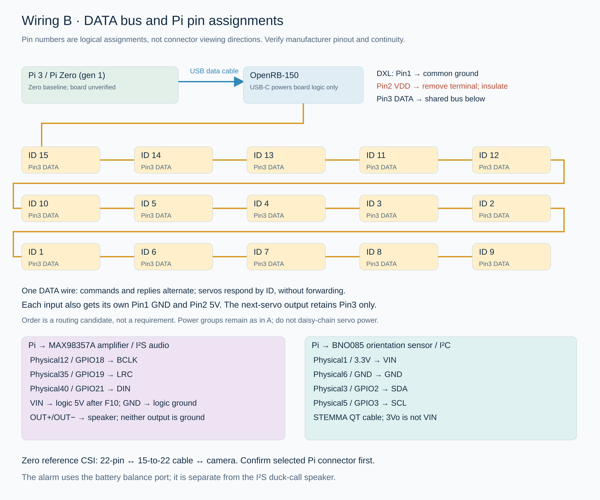

# MicroDuck assembly manual

**Historical component reference.** Use the [current assembly guide](../redesign-20260913/ASSEMBLY.html) and [current hardware handbook](../redesign-20260913/START-HERE.html). The current robot includes camera and audio, uses one DFR1202 converter and the 89-instance print queue. This archived sequence includes superseded power, alarm, USB, head-cap and screw-length instructions; do not use its fastener totals or wiring as the current installation recipe.

2026-09-13 · P5 onboard hardware / P6 physical deployment.

**15 total actuators, including one jaw actuator.** The purchase split is fourteen standalone XL330 motors plus one supplied with the starter kit. All fifteen have a distinct installation position.

This manual joins the real printed structure, servo geometry and current electronics into an assembly sequence. The frame, motors, OpenRB and carriers use CAD meshes. Battery, regulators, amplifier, speaker and alarm use supplier-dimension installation envelopes. An envelope reserves space; it is not a photograph of a received or installed component.

The files support harness fabrication, first-article printing and module assembly. Physical fit, electrical acceptance and calibrated motion are still required before unsupported walking. Current repairs include the narrower two-tier fuse carrier, cap clearance and a new integral jaw sliding seat that removes the original 0.2 mm axis mismatch.

Use the [print list](PRINT-LIST.md), [procurement list](../procurement/README.zh.md), [final wiring specification](../power/WIRING.md), [first-power procedure](../power/FIRST-POWER-TEST.md) and [purchase-impact report](purchasing-impact.md) together. The current wiring uses eight fused groups and fifteen independent servo power inputs.

## 1. Sort and prepare the parts

Sort prints into head, neck, torso, left leg and right leg. Keep sliding rings, passive idlers and caps in a separate tray. Match short source filenames to the numbered catalogs; do not infer left/right from a filename.

Prepare calipers, a small Phillips driver, M2/M3 tools, tweezers, pliers, deburring tools, a multimeter and soldering equipment. Leave the battery disconnected. Clear all support material, especially shaft bores, the regulator pocket, the lower fuse tier, switch saddle and camera-ribbon slot. Inspect for splitting, blocked pilot holes and delamination. Tighten plastic interfaces by hand.

The complete print inventory is **64 retained source instances + 11 current parts + 14 additional idlers/caps = 89 instances**. The extra copies provide 14 idlers and 14 caps in total as a stocking allowance. The exact installed/spare split is recorded per joint; it is not inferred from the print count. Source cap ID6, power support ID12 and head motor support ID24 are superseded.

PLA is the current baseline. Changing material, scale, wall count or foot pads changes fit, mass or friction and requires the corresponding check.

## 2. Label and center all fifteen motors before attaching links

An XL330 has a stationary case and a rotating output. Attach these to opposite sides of a joint. Fastening both to the same rigid link locks the joint. The XL330 already has an integrated output mounting face; do not stack an extra set of fifteen HNX output horns on it.

1. Connect only one unassigned motor to the current-limited 5 V bench setup. Multiple factory-default IDs must not share the configuration bus.
2. Read its model, firmware and position with DYNAMIXEL Wizard 2.0 or the project tool. Assign the intended ID, read it back and attach a label.
3. Select position-control mode and center the unloaded shaft slowly. The 0–4095 position range has midpoint 2048; that number alone is not the robot's mechanical zero.
4. Disable torque, align the link and fasten its output screws. Read the position again to detect movement during tightening.
5. Record encoder position, model zero, positive direction and measured offset for every joint. The source author's knee offsets are not measurements of this robot.

Use **M2 x 6 TAP through a 3 mm output frame**. ROBOTIS explicitly warns that an M2 x 8 screw at that output location can reach and damage the case. Case-hole screw lengths still depend on the actual printed stack. [ROBOTIS assembly guidance](https://emanual.robotis.com/docs/en/dxl/x/xl330-m288/#how-to-assemble) and [position register](https://emanual.robotis.com/docs/en/dxl/x/xl330-m288/#goal-position116).

Right leg, from foot upward: ID1 ankle, ID2 knee, ID3 hip pitch, ID4 hip roll, ID5 hip yaw. Left leg: IDs6–10 in the same order. ID11 head pitch, ID12 neck pitch, ID13 head yaw, ID14 head roll. ID15 is the jaw. Encoder centering, model zero and standing posture are separate calibration records.

## 3. Install the small regulator before the hip motors

Use `power-support-integrated-print.stl` in place of source `a.obj / ID12`. It retains the original torso/motor interfaces and provides a central pocket for the small regulator, an underside mount for the large regulator and a rear battery cradle.

Solder and insulate S13V30F5 VIN, GND and VOUT flying leads before inserting the board between the hip motors. This pocket does not accommodate optional tall screw terminals. Fit the cover with **four M2 x 12 machine screws into the 1.6 mm plastic pilot holes**, alternating gently. The cover must bear on the intended support surfaces, not components. Route wires through the opening. Complete this step before adjacent hip motors reduce access.

## 4. Build the fused harness and fit the large regulator

Fabricate, insulate, label and continuity-check eleven fuses on the bench: F0 10 A; F1–F8 3 A for the eight servo groups; F9 3 A at the logic regulator input; F10 0.5 A on the audio branch. Label the F-number; appearance does not establish the rating.

Each insulated fuse assembly must fit **24 x 5 x 5 mm**. The carrier has six upper and five lower slots, 5.4 mm channel width and 6.5 mm lower-tier height. Remove internal supports through the open axial ends. Load the lower five from an end, then the upper six. Four Panduit PLT2M-C ties (203 x 2.5 x 1.1 mm) retain the insulated lead sections and must not crush a fuse body or cut heat-shrink tubing.

Place F0 near the EC2 battery-positive entry, F9 near the small-regulator input and F10 at the audio branch origin. Arrange the remaining fuses to suit actual wiring. Geometric slot numbers do not assign electrical F-numbers.

The large D42V110F5 board sits on **four integral 2 mm printed spacers**; do not add separate spacers. Its four mounting centers match the former board. The manufacturer profile has 1.8 mm underside components, leaving only 0.2 mm nominal over the shelf. Check that every component and solder fillet clears the printed shelf and spacer edges; trim solder tails, not components. Do not tighten the board down onto a component. The replacement requires no nominal mount change; see [power selection](../power/cost-review/README.md). Align the fuse carrier below the same four holes. Use **four M2 x 20 screws and four M2 nuts**, replacing the former M2 x 8 screws. Confirm actual board thickness, nut engagement and screwdriver access on the first print. Preserve the air gap above the board and keep its heat-dissipating surfaces exposed.

## 5. Assemble the torso and both legs

Fit torso base `m.obj / ID34`, hip-yaw motors ID5/10 and the integrated power support. Align shafts and circular openings before tightening either side. Leave the battery out.

Left-leg order: ID10 output → `n/o.obj` yaw-to-roll link → ID9 → `b.obj` hip bracket → ID8 and `gbgb.obj` thigh → ID7 knee → `k/l.obj` lower-leg links → ID6 ankle → left foot. Mirror the parts for ID5→4→3→2→1 on the right. The `f/g.obj` thin pieces reinforce the thighs.

Install both the active output and its opposite passive support coaxially. Fasten the case, output link and passive side in sequence. With torque disabled, check a small permitted movement after each joint; there must be no scraping, looseness or binding. Photograph the shaft and zero-position label before covering the joint.

**Selected support route: community printed sliding supports.** The large printed rings are approximately OD22 / ID16.4 / thickness4 mm, providing nominal 0.2 mm radial clearance around a 16 mm flange. They slide; they are not rolling ball bearings. Keep the community ankles and combined feet as matched pairs. Do not stack the official metal-bearing route onto them. The ankle output interface has four diameter2.2 mm holes on a 6 mm radius and diameter4.4 mm head recesses. The passive seat is diameter15 mm; its printed small ring is OD14.6 / approximately ID9.64 mm. Outer seat clearance is nominally 0.2 mm radial; verify the inner shaft fit physically. The two small source rings are reserved for the community ankle assemblies, not the repaired mouth seat.

The source has ten large-ring stations coaxial with motor shafts plus one structural pivot. Its motor mesh merges both side flanges, so it does not provide a trustworthy installed idler/cap breakdown. Stocking fourteen printed pairs covers at most one per non-jaw motor; install only where the passive-side construction requires one and record the remainder as spares. Each installed idler/cap center uses **one original ROBOTIS BHS M2.6 x 6 TAP screw**. Source matching screws from RoboClub first. No FPX330-H101 kit purchase is selected. The former two-pack option is only a reference for sixteen factory screws; record any exact club-stock mismatch before changing the sourcing decision.

The fifteen motor boxes supply 90 M2 x 6 TAP and 150 M2 x 8 TAP screws. That inventory covers four output screws per motor and an eight-case-screw-per-motor upper bound; it does not prove every hole takes either length. Before repeating a joint type, measure its printed stack and allowed hole penetration, select the correct supplied length and record its per-hole count. Do not put long electronics screws into servo plastic.

## 6. Install the neck and route the head harness

Install neck-pitch ID12 and head-pitch ID11 with `d/e.obj` and `j.obj`; add yaw ID13 with `dfbdfbbbbb1.obj`, then roll ID14. Match output directions to the ID figure.

Separate servo power, shared DATA, Pi power, audio power and IMU wiring by destination. Pass flexible loops around the outside of joints, clear of output flanges and bearing end faces. Secure both ends while leaving the bending section free. Move each joint through its calibrated range before tightening ties.

The digital checks cover rigid parts and reserved envelopes. Flexible-wire bending, rubbing, fatigue and complete path lengths still require the actual harness. Measure the longest one-way power runs against the electrical limits; do not replace a required wire gauge merely because a thinner wire fits more easily.

## 7. Install the jaw and its repaired sliding seat

Use **`motor-support-coaxial-print.stl` instead of h.obj / ID24**. ID15 mounts to this support. The active side of `4.obj / ID4` attaches to the integrated motor output; the opposite jaw boss runs in the new support's integral sliding seat. Lower pad `q.obj / ID42` moves with the jaw; upper pad `p.obj / ID40` stays fixed. Dry-fit first and do not bond both pads together.

The source jaw's two fitted circular centers and motor output share **X3.0, Z−18 mm** in the head frame. The old bearing seat was at X3.2. The replacement keeps the mounting interfaces and adds a fixed eccentric seat: **10.4 mm bore on the X3.0 axis**, nominal 0.2 mm radial clearance and 0.3 mm flange clearance. It replaces the separate mouth bearing; no additional mouth ring is required.

Use **`head-cap-mouth-clearance-print.stl`**, retaining the local cap relief. The added support material has no overlap against 41 checked head objects. A separate jaw rotation check has **61 collision-free sampled poses from 0 to 30 degrees in 0.5-degree increments**, including the retained upper pad and current head electronics. The original constant bearing overlap is removed by the replacement, not ignored by the checker.

These are digital geometry results. The source XML still lacks an actuated fifteenth joint, and the walking policy uses IDs1–14. Before powering ID15, verify free movement, actual shaft alignment, pad attachment and print friction with torque off. Then calibrate a small motion, closed position, soft limits and current limit. The scanned 30 degrees is a candidate range, not an automatic firmware limit or proof of grasping.

## 8. Install Pi, OpenRB, amplifier and speaker

Align Pi Zero 2 W with the four blind pilot holes in face panel `ghmghmghmghm.obj / ID76`. Use **four M2.5 x 6 tapping screws, no nuts**. The modeled PCB is about 1.6 mm thick, its holes about 2.7 mm, and the face-panel pilots about 2 mm diameter by 5.5 mm deep. A 6 mm screw enters about 4.4 mm after passing the PCB, leaving about 1.1 mm depth margin. Heads up to diameter4.5 x height1.8 mm were checked. Tighten diagonal pairs gently and confirm first-print thread engagement without bending the board.

OpenRB uses **four M2 x 18 screws and four M2 nuts** on the cap posts. The audio carrier uses **two M2 x 25 screws and two M2 nuts**. The ten head M2 screw envelopes were checked at maximum diameter4 x height1.72 mm.

Retain MAX98357A in its slot with thin insulation under solder points and two tie loops around carrier edges. Each audio loop joins two PLT.6SM-C short ties; the amplifier and speaker need four loops / eight short ties total. Their 2.4 x 1.2 mm slots do not accept the wider fuse ties. Position joined locks outside the slots and verify clearance. Keep ties off chips and headers. The Adafruit3923 speaker sits in the other slot; secure its rim and leave the diaphragm free. This speaker produces duck sounds; the battery alarm's buzzer serves only as a low-voltage alert.

Connect audio before closing the cap. Speaker OUT+ and OUT− both go to the speaker; neither connects to ground. Keep wires clear of the lens, jaw and head axes.

## 9. Install the monocular camera and ribbon

Mount Camera Module 3 Wide in the cradle with **four M2 x 8 screws and four M2 nuts**, bearing only on PCB corners. The tilt hinge uses **one M3 x 20, two M3 washers and one M3 nut**. The foot uses **two M3 x 10, two 0.5 mm M3 washers and two M3 nuts**. Do not restore the longer M3 x 20 foot screws; they extend into the head.

Use a **15-to-22-pin ribbon**: wide 15-pin end at the camera, narrow 22-pin end at Pi Zero CSI. Disconnect power before opening the latches. At the camera, metal contacts face the camera PCB. At Pi, contacts face away from the locking bar; verify the connector rather than guessing from the blue stiffener. Lift the latch gently, insert squarely and fully, then relock. [Raspberry Pi camera connection instructions](https://www.raspberrypi.com/documentation/accessories/camera.html#connect-the-camera).

Route a smooth ribbon bend through the cap slot, clear of screw posts. Verify a live preview before closing, then turn the head and check for interruptions. Start at **0–15 degrees downward tilt**, the geometrically checked clear range; around 20 degrees the cap may enter the view. Clear sightlines do not establish depth calibration. A stereo camera change requires a new mechanical and head-load check.

## 10. Fit the torso IMU, removable alarm and ENA switch

Mount the BNO085 in the torso clamp, not the independently moving head. Its reservation is 28 x 25 x 8 mm. Keep the board-axis marking visible and record its orientation. Clamp onto the support rails with **two M2 x 5 screws**. Stack the alarm carrier outside the IMU rear cover using **four M2 x 8 screws** into the original pilot holes.

Place the 38 x 25 x 11 mm alarm with its 38 mm axis transverse and its header toward the side window. Reserve **12 mm straight plug length plus 10 mm wire bend** beyond the body. Two retaining loops secure its rim, clear of LEDs and buzzers. Each loop joins three PLT.6SM-C ties (71 x 1.8 x 0.8 mm), six short ties total; locate the joined locks outside the component and verify their clearance. A 2.5 mm-wide tie does not fit the 2.2 mm slot direction. The supplier does not provide a dimensioned header location; measure it on arrival. If offset, revise only the small carrier window, not the live pins. The 2S connector occupies the first three positions starting at the marked minus terminal; the other pins remain empty. Use the 150 mm JST-XH3 extension.

The projecting saddle above the alarm holds Pololu1408. Solder the center and one outer terminal to regulator ENA/GND according to the wiring page; insulate and verify the two switch positions. The body is **8.5 x 3.7 x 3.5 mm**. The base opening reserves **2.4 x 6.8 x 11.5 mm** for trimmed, insulated terminals. Supplier pin length is unspecified; this is a fabrication limit to measure.

One **PLT.6SM-C tie, 71 x 1.8 x 0.8 mm**, secures the outer metal rim through the saddle slots. Keep the slider and terminals clear. Verify full travel after tightening. This switch disables only the servo regulator. Pi and the alarm remain powered.

## 11. Connect fifteen power inputs and one shared DATA bus

The large regulator powers the motors. The small regulator powers Pi, OpenRB logic and audio. **Do not join their 5 V outputs. Connect the grounds at the specified common point.** Use the specified main, group and individual-tail wire gauges. No motor receives its power through another motor.

DYNAMIXEL pins are **1 GND, 2 VDD, 3 DATA**. Each motor's input gets its own 1/2 power pair from its assigned fused Y-branch. The outgoing connector keeps only pin3; remove pins1/2. OpenRB uses pin3 DATA, pin1 to the common ground and an empty, insulated pin2. With power off, remove each fuse and verify that its group's VDD is isolated, ruling out bypasses through ordinary three-wire cables.

The fifteen included 180 mm X3P cables can become thirty original-crimp tails: fifteen motor inputs, fourteen DATA-only outputs and one OpenRB connector. Follow the [exact tail-conversion instructions](../power/WIRING.md#reusing-the-fifteen-included-x3p180-cables). Wire color never replaces pin identification.

Pi PWR IN receives logic 5 V. Its other USB port operates as OTG host to OpenRB USB-C. Both Pi ends use bare Adafruit1826 MicroB connectors. Power: pin1 +5 V and pin5 GND only. Data: retain the original twisted pair and USB-C end, connect pins1/2/3/5 to VBUS/D−/D+/GND and tie pin4 ID to pin5. The full bare connector length was conservatively checked outside the PCB edge, with **14.5 x 9.5 x 7 mm after-insulation allowance**. The 26 mm plastic housing is not accepted for this space. Measure solder tails, strain relief and the actual USB-C molded plug, then pass the 30-minute USB communication check.

Audio I²S: Pi physical12/GPIO18 → BCLK; physical35/GPIO19 → LRC; physical40/GPIO21 → DIN. Amplifier VIN receives 5 V through audio fuse F10 directly from the small-regulator branch; GND returns to logic ground. Fit the 100 kΩ low-gain resistor as specified. Do not route audio power through the Pi board.

IMU I²C: Pi physical1/3.3 V → VIN; physical6 → GND; physical3/GPIO2 → SDA; physical5/GPIO3 → SCL. A STEMMA QT-to-female cable avoids soldering this sensor connection. Leave a bending loop through the neck.

## 12. Install the removable battery and complete bench acceptance

The battery envelope is **22 x 34 x 63 mm**, for Gens ace GEA8502S60E2. Measure the actual wrap, label and lead exit. Never cut or compress the battery to fit a print.

Insert it from the rear into the stops. Two **4.8 mm-wide ties, at least 200 mm long**, pass through the side slots at different heights. Keep locks rearward for removal. Use a thin closed-cell insulating pad with finished thickness at most 1.0 mm, including any retained liner. Adhesive is not mechanically required; the ties retain the pad. If using double-coated 3M4492W, keep the battery-facing release liner in place. The pad protects the wrap; printed stops and ties carry the load. Releasable ties are acceptable only after checking their lock size and linkage clearance. Remove the battery by unplugging EC2, releasing or replacing the ties and sliding it rearward.

Keep EC2 reachable from the rear. The ENA switch and an OpenRB restart are not complete power isolation. Unplug **EC2 and then the alarm's balance connector** for full shutdown.

Follow the first-power document with the robot supported: continuity, group isolation, every motor ID/voltage, Pi camera/Wi-Fi/audio, IMU, USB stability, all six load conditions and temperature measurements. Progress to small joint motions, then slow supported standing. The old simulation suite does not certify the actual mass or electrical behavior of this revised robot.

## 13. Soldered and plug-in connections

Required soldering: the second onboard GEAX6F2E2M adapter after removing XT60; its EC2 tail to F0/main wiring; both regulator leads; ENA/GND switch leads; power star/Y joints; eleven fuses; modified DATA connections; both bare MicroB cables; amplifier gain resistor and signal connections. A bare Pi also requires the 2 x 20 header to be soldered.

Plug-in options: CSI ribbon; BNO085 STEMMA QT cable; speaker through the amplifier's pre-soldered terminals; the first complete GEAX6F2E2M adapter reserved for charging; alarm balance extension. A correctly oriented pre-soldered Pi header avoids that soldering step without adding a tall adapter board.

The compact head does not accept arbitrary large solderless adapters. A prepared removable harness is suitable once it passes unpowered continuity, short-circuit, gentle-pull and bench checks.

## 14. Evidence and remaining first-article measurements

Completed digital work: source extraction and frozen-hash checks; all current parts and the complete inventory sliced in Bambu; head M2 and Pi mounting checks; bare USB envelopes; the fuse/alarm/ENA mounts and tie paths checked over 250 recorded poses and 408250 candidate pairs; jaw-support static check and 61 clear jaw-opening samples.

Still requiring physical evidence: original case-hole stack depths and installed screw counts; printed sliding-fit friction and the matched community ankle/foot interfaces; per-station idler/cap use; Pi thread engagement; alarm header offset; insulated plugs/fuses and tie-lock dimensions; flexible wiring over complete motion; support removal and printed strength; whole-robot weight, electrical loads and calibrated dynamics. Enter each result in the [first-article record](FIRST-ARTICLE.md). A failure needs its part ID, photo and measurement, followed by a local revision and recheck.
