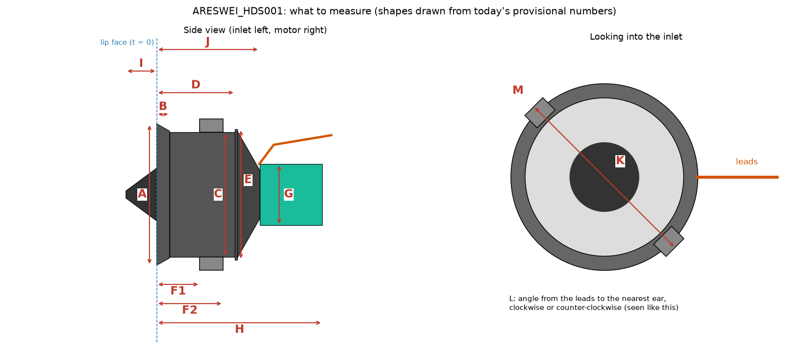

# 风扇到货后要量的尺寸（ARESWEI HDS001，50 mm 涵道风扇）

现在的风扇罩（nacelle，黑色那一盘）是按商品图估出来的尺寸画的，**量完之前不打印**。你用卡尺量下面这些数，把字母和数字发给我就行（例如 `C 51.8`），我只改一组参数然后重建。

## 量之前

- 拿 **CW（绿色电机）一个、CCW（红色电机）一个**，下面 A 到 F2 两个都量。两个外壳应该一样，不一样就两组都发给我。
- **前面的喇叭口（进风圈）装着量**，它是可拆的。拆下来看一眼它怎么固定（卡上、拧上还是胶粘），告诉我一句话就行。
- 别拧扇叶中间的螺丝，商家说会破坏动平衡。
- 下面说的“唇口端面”就是喇叭口最前面那一圈平面，图里蓝色虚线的位置，所有长度都从这里量起。

## 要量的尺寸

1. **A 喇叭口外径**：喇叭口最大那一圈的直径，卡尺外量爪夹住。现在按 59 算。
2. **B 喇叭口有多长**：从唇口端面量到圆管开始变直的地方。现在按 5.4 算。
3. **C 直管外径**：喇叭口和后面那圈凸边之间的直圆管，**换三个方向各量一次，三个数都发给我**。风扇罩靠夹住这一段固定，这个数最要紧。现在按 52.0 算，商品图估出来在 50.3 到 54.5 之间。
4. **D 直管的终点**：从唇口端面量到后面那圈凸边的前沿（卡尺深度尺或者直尺贴着量）。现在按 32.6 算。
5. **E 后面凸边外径，以及它有多厚**：直管尾部那一圈稍微凸出来的边。量直径，再量它沿轴向有多厚。现在按直径 54.6、厚 1.0 算。
6. **F1、F2 耳朵的前后位置**：外壳侧面有两个带螺丝孔的小方块（耳朵）。从唇口端面分别量到耳朵前沿（F1）和后沿（F2）。现在按 17.9 和 27.6 算。
7. **G 电机外径**：后面绿色或红色电机外壳的直径。现在按 25.5 算。
8. **H 总长到电机尾**：从唇口端面量到电机最后面（包括露出来的轴头）。现在按 69 算。
9. **I 尖头高出多少**：扇叶中间的黑色尖头从唇口端面往前凸出多少。把风扇口朝上放在桌上，直尺横搭在唇口上，量尖头顶到直尺的距离。现在按 12.8 算。
10. **J 出线位置**：三根电机线从电机前端离开的地方，到唇口端面的距离。现在按 41 到 44.5 算。
11. **K 两个耳朵外端之间的距离**：两个耳朵最外面之间的直线距离。现在按 63 算，也就是每个耳朵外端离中心 31.5。
12. **M 耳朵本身**：耳朵沿圆周方向有多宽，螺丝孔直径多少，**孔朝哪个方向打的**：朝外（垂直于圆管），还是和圆管轴线平行。现在按宽 8 算，孔没用上。
13. **L 出线方向和耳朵的关系**：风扇口朝上，从上往下看进风口（和图右边那张一样），从出线的方向转到最近的那个耳朵，告诉我是**顺时针还是逆时针**、大约多少度。商品图看着是逆时针 45 度。
14. **电机线长度**：从线离开电机的地方量到香蕉头的头。商家说大约 140。
15. **重量**（有秤就称，没有就算了）：商家说 77 g。

## 这些数改什么（给我自己看）

所有尺寸都在 `cad/flight_params.py` 的 `FANS["ARESWEI_HDS001"]` 里：A 对应 `lip_od`，B 对应 `lip_t`，C 对应 `duct_od`，D 对应 `duct_t`，E 对应 `rim_od`/`rim_t`，F1/F2 对应 `ear_t`，K 对应 `ear_r`（K 的一半），M 对应 `ear_w`，L 对应 `ear_from_lead_deg`，G 对应 `motor_od`，H 对应 `motor_t`，I 对应 `spinner_t`，J 对应 `lead_t`，线长对应 `lead_len`，重量对应 `mass_g`。风扇罩的孔径、夹紧长度、耳朵槽、螺丝位置、中间连接块、腿部间隙检查和电机线长度都从这组数自动算出来。改完以后依次跑 `build_pack.py`、`check_parts.py`、`lead_lengths.py`、`update_layout.py`、`../leg_load.py`、`make_access_spec.py`，最后重新切黑色那一盘。
